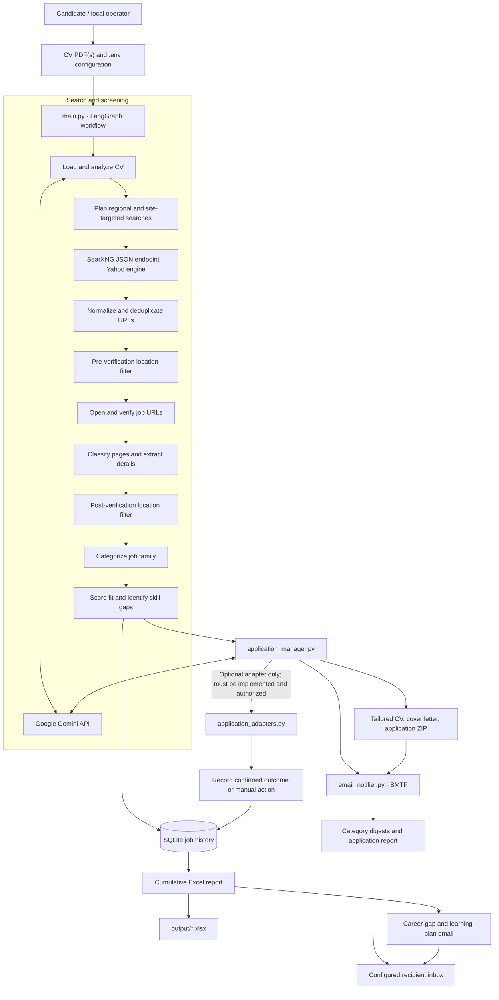
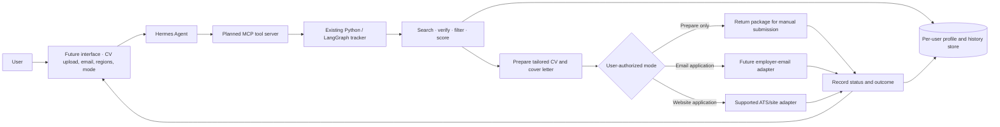

# Job Tracker Agent

A Python-based job-search and application-preparation assistant built with **LangGraph**, **Google Gemini**, and **SearXNG**. It searches for vacancies, verifies job URLs, applies a configurable location filter, compares jobs with a candidate CV, records results in SQLite and Excel, and emails job digests and tailored application documents.

> **Project status:** Job discovery, URL screening, target-location filtering, CV/job matching, report generation, email notifications, and application-document preparation are part of the current workflow. Website auto-submission is **not guaranteed by enabling a flag alone**: it requires a separately implemented and tested adapter. Hermes integration and a multi-user upload interface are future enhancements, not part of the current workflow unless added separately.

## Contents

- [Features](#features)
- [System architecture](#system-architecture)
- [Technology stack](#technology-stack)
- [Requirements](#requirements)
- [Setup on Windows](#setup-on-windows)
- [Configuration](#configuration)
- [Location filtering](#location-filtering)
- [Run the workflow](#run-the-workflow)
- [Reports and output files](#reports-and-output-files)
- [Application preparation vs. auto-apply](#application-preparation-vs-auto-apply)
- [Planned Hermes integration](#planned-hermes-integration)
- [Limitations and responsible use](#limitations-and-responsible-use)
- [Security and privacy](#security-and-privacy)
- [Troubleshooting](#troubleshooting)

## Features

- **CV-based search planning:** extracts text from selectable-text PDF CVs and builds a candidate profile to guide job searches and matching.
- **Multiple CVs:** supports a comma-separated `CV_PATHS` list. Each CV is processed separately and can have its own job history database/report.
- **Regional and targeted search:** sends search requests to a local SearXNG JSON endpoint, using Yahoo as the selected engine, and adds targeted domain searches for sites such as LinkedIn Jobs, Indeed, Bayt, GulfTalent, Naukrigulf, Laimoon, Foundit Gulf, Dubizzle, Oliv, and Jora.
- **Duplicate reduction:** normalizes job URLs and removes duplicate leads before verification and assessment.
- **Vacancy-page verification:** inspects available page content and structured job data to distinguish individual vacancy pages from search/listing pages, courses, advertisements, informational pages, unavailable pages, and uncertain results.
- **Two-stage location filtering:** filters explicit out-of-scope locations before URL verification and checks location again after opening/classifying pages. Unknown primary locations are kept for manual review instead of automatically being treated as eligible.
- **Role categorization and fit scoring:** uses Gemini to categorize jobs, estimate fit against the CV, explain the match, and identify missing skills.
- **Separate email digests:** sends stronger matches in role-category emails and sends a separate lower-fit/career-gap email with a suggested learning plan, when email delivery is enabled and configured.
- **Tailored application documents:** prepares a job-specific CV and cover letter for eligible matches and organizes available files into application packages.
- **Persistent records:** stores job/application history in SQLite and creates cumulative Excel workbooks with clickable job URLs.
- **Manual review path:** retains uncertain or blocked URLs for inspection instead of presenting them as fully verified vacancies.

Search coverage depends on the upstream search engine, indexing, site restrictions, and rate limits. The project does not guarantee that it will find every vacancy on any job board.

## System architecture

### Current workflow

The current Python workflow is orchestrated by LangGraph in `main.py`.



### Main modules

| File / service | Responsibility |
|---|---|
| `main.py` | LangGraph orchestration, CV loading, search planning, URL verification, location filtering, categorization, fit scoring, persistence, Excel export, and workflow routing. |
| `application_manager.py` | Generates tailored application documents, stores application statuses, and can delegate a submission attempt to a registered adapter when the configuration and adapter permit it. |
| `application_adapters.py` | Optional adapter entry point. Actual application-submission capability depends on the code implemented and tested in this module. |
| `email_notifier.py` | Sends job digests, application reports, and career-feedback emails through configured SMTP. |
| SearXNG | Search endpoint used to discover indexed job URLs. It must be running and reachable separately. |
| Google Gemini | Supports CV/job analysis, categorization, match reasoning, and generation of tailored documents. |
| SQLite and Excel | Persist job/application records and provide a cumulative, human-readable report. |

## Technology stack

- Python 3.11 or newer
- LangGraph for workflow orchestration
- Google Gemini via LangChain's Google GenAI integration
- SearXNG JSON API for job discovery
- PyMuPDF for PDF CV text extraction
- Pydantic for structured model outputs
- SQLite for persistent records
- OpenPyXL for Excel reports
- python-docx for tailored Word documents
- SMTP for email delivery

## Requirements

Before running the workflow, prepare:

1. Python 3.11+.
2. A Google Gemini API key with access to the configured model.
3. A running SearXNG instance exposing a JSON search endpoint. The default is `http://localhost:8888/search`; set `SEARXNG_URL` if your endpoint differs.
4. One or more PDF CVs with selectable text.
5. SMTP account credentials if you want the workflow to email reports. For Gmail, use an App Password where required rather than your normal account password.

## Setup on Windows

Open PowerShell in the repository folder. The commands below assume the repository folder is named `job-tracker-agent`.

### 1. Create a virtual environment and install dependencies

```powershell
py -3.11 -m venv .venv
.\.venv\Scripts\Activate.ps1
python -m pip install --upgrade pip
pip install -r requirements.txt
```

If PowerShell blocks virtual-environment activation, either follow your organization's execution-policy guidance or run the environment's Python executable directly, as shown below.

### 2. Create your local configuration

```powershell
Copy-Item .env.example .env
notepad .env
```

Add your own configuration to `.env`. Keep this file local and never commit it.

### 3. Add your CV file(s)

Place your own PDF CV(s) in the project folder, or set `CV_PATH` / `CV_PATHS` to their paths in `.env`.

Example for one CV:

```dotenv
CV_PATH=my_cv.pdf
```

Example for two CVs:

```dotenv
CV_PATHS=my_cv.pdf,another_cv.pdf
```

`CV_PATHS` is comma-separated, so avoid commas in the file paths. Do not add real CV files to Git.

### 4. Configure and test SearXNG

Make sure your SearXNG service is already running and that its JSON endpoint is reachable. For the default local endpoint, test it with PowerShell:

```powershell
Invoke-RestMethod "http://localhost:8888/search?q=cloud+engineer&format=json&engines=yahoo"
```

The response should contain a `results` array. If the request fails, check the service, its URL, network access, and whether the Yahoo engine is enabled. The tracker does not install or manage your SearXNG service automatically.

### 5. Configure required values

At minimum, set `GOOGLE_API_KEY` and the correct CV path. Configure SMTP values and recipient addresses if email notifications are required. See [Configuration](#configuration).

### 6. Check syntax and run

From the repository root:

```powershell
.\.venv\Scripts\python.exe -m py_compile main.py application_manager.py email_notifier.py
.\.venv\Scripts\python.exe main.py
```

The first run can take time because it performs external searches, requests job pages, and calls the configured language model. Keep the terminal open so you can see progress and errors.

## Configuration

All secrets and machine-specific paths belong in `.env`, not in source code or Git. The variables below are the most important settings; check `.env.example` and the current source for the full set supported by your version.

| Variable | Purpose |
|---|---|
| `GOOGLE_API_KEY` | Required Google Gemini API key. |
| `GEMINI_MODEL` | Gemini model name used by the workflow. |
| `CV_PATH` | Path to one PDF CV when using a single candidate. |
| `CV_PATHS` | Comma-separated PDF paths; each CV is processed separately. Takes precedence over `CV_PATH` when set. |
| `SEARXNG_URL` | SearXNG JSON search endpoint; default is `http://localhost:8888/search`. |
| `ALLOWED_JOB_COUNTRIES` | Optional comma-separated location allow-list override. If omitted, the built-in default scope is used. |
| `SMTP_EMAIL` | Sender email account for notifications. |
| `SMTP_APP_PASSWORD` | SMTP password or provider-specific app password. Keep it secret. |
| `SMTP_HOST` / `SMTP_PORT` | SMTP server and port; common Gmail defaults are `smtp.gmail.com` and `587`. |
| `MY_CV_EMAILS` | Recipient address(es) for the primary candidate's reports/digests. Multiple addresses may be comma-separated. |
| `AHMED_CV_EMAIL` | Recipient for the CV identified by `AHMED_CV_KEYWORDS`. Set this explicitly in `.env`; remove any hard-coded personal fallback from source code before publishing. |
| `AHMED_CV_KEYWORDS` | Comma-separated filename keywords used to identify that CV. |
| `OUTPUT_DIR` | Directory for databases, reports, and generated application packages; default is `output`. |
| `MAX_RESULTS_PER_REGION` | Requested search-result cap per regional search. |
| `MAX_RESULTS_PER_SITE` | Requested result cap for targeted site searches. |
| `MAX_RESULTS_PER_LINKEDIN_QUERY` | Requested result cap for each targeted LinkedIn query; not a guarantee of unique jobs. |
| `MAX_JOB_URLS_TO_VERIFY` | Maximum number of URLs to verify in a run. |
| `MAX_JOBS_TO_ASSESS` | Maximum number of vacancies to score. |
| `JOB_URL_TIMEOUT` | Timeout for an individual job-page request, in seconds. |
| `JOB_URL_VERIFY_WORKERS` | Concurrent workers used for URL verification. |
| `JOB_ASSESSMENT_BATCH_SIZE` | Batch size for model-based job assessment, where supported. |
| `STRONG_FIT_MIN_SCORE` | Minimum match score for inclusion in strong-fit category emails; default is `75`. |
| `APPLICATION_MIN_FIT_SCORE` | Minimum score for preparing tailored application documents; default is `80`. |
| `MAX_APPLICATION_PACKAGES_PER_RUN` | Cap on application packages generated per run. |
| `VERIFY_JOB_URLS` | Enable/disable job URL verification; normally keep this `true`. |
| `SEND_JOB_DIGEST_EMAILS` | Enable/disable category job-digest emails. |
| `SEND_CAREER_FEEDBACK_EMAIL` | Enable/disable the final career-gap/learning-plan email. |
| `AUTO_APPLY_ENABLED` | Defaults to `false`. Enabling it does not itself create an application adapter. |

### Example location setting

The built-in default scope allows European countries plus Egypt, the United Arab Emirates, Saudi Arabia, Qatar, Kuwait, Oman, and Bahrain. To specify that scope explicitly in `.env`, use:

```dotenv
ALLOWED_JOB_COUNTRIES=Europe,Egypt,United Arab Emirates,Saudi Arabia,Qatar,Kuwait,Oman,Bahrain
```

Edit an existing `ALLOWED_JOB_COUNTRIES` entry rather than creating duplicate entries. `Europe` represents the built-in list of European countries.

### Email routing notes

- `SMTP_EMAIL` and `SMTP_APP_PASSWORD` configure the account that sends notifications.
- Candidate recipient variables such as `MY_CV_EMAILS` and `AHMED_CV_EMAIL` determine where reports are delivered.
- These notification emails are not the same as sending an application to an employer. Employer-directed application emails require a specifically implemented and verified application adapter with a confirmed employer recipient.

## Location filtering

Location is checked at two points in the workflow:

1. **Before URL verification:** when the search result provides explicit evidence of a primary work location outside the allow-list, the result is excluded before spending time opening the page.
2. **After page verification:** the workflow checks available structured job data and visible-page/search evidence again. A vacancy only proceeds to fit scoring when the primary location can be matched to the configured scope.

Explicit non-target locations are excluded from scoring and application preparation. Vacancies with unknown or ambiguous primary locations are sent to the **Needs Manual Review** sheet instead of being automatically treated as eligible. Out-of-scope records can be retained in the report/database for auditing.

Location detection depends on available page and search-result evidence. A missing location is not proof that a job is in scope; manually review uncertain records.

## Run the workflow

From the repository root, with `.env`, dependencies, CVs, and SearXNG configured:

```powershell
.\.venv\Scripts\python.exe main.py
```

The workflow processes each configured CV independently. Its general sequence is:

1. Load and analyze the CV.
2. Plan broad regional and targeted site searches.
3. Search through SearXNG and collect job URLs.
4. Normalize/deduplicate results.
5. Apply the first location filter and verify job URLs.
6. Classify vacancy pages and enforce the location filter again.
7. Categorize in-scope vacancies and score them against the candidate profile.
8. Persist results, prepare application documents for qualifying vacancies, send configured notifications, and export the Excel report.

Thresholds have different purposes: `STRONG_FIT_MIN_SCORE` controls the strong-fit email split, while `APPLICATION_MIN_FIT_SCORE` controls which jobs qualify for document preparation. Adjust them independently if needed.

## Reports and output files

The default `output/` directory is intended for local data and is excluded from version control. Depending on the configured CVs and workflow version, it can contain:

- `jobs.db` for a single-CV run, or candidate-specific `jobs_<cv-label>.db` databases for multiple CVs.
- `job_history_<cv-label>.xlsx`, a cumulative Excel report.
- Generated application folders containing tailored CV/cover-letter documents and application metadata.
- ZIP files containing available application documents for review.

The Excel workbook includes these worksheets:

- **All Discovered Leads** — the cumulative lead ledger.
- **Verified & Scored** — individual vacancy pages that passed verification and have a fit score.
- **Needs Manual Review** — ambiguous, blocked, or otherwise unconfirmed leads.
- **Excluded Non-Jobs** — non-vacancy pages, unavailable pages, and explicitly out-of-scope locations.

Job URLs in the report are clickable. Keep the entire `output/` directory private because the database, reports, and generated documents may contain personal information.

## Application preparation vs. auto-apply

The current project can generate tailored CVs and cover letters and can track application-related statuses. **Generating documents is not the same as submitting an application.**

- `AUTO_APPLY_ENABLED` is `false` by default.
- The application manager only delegates to the `try_submit_with_authorized_adapter(...)` entry point when auto-apply is enabled.
- A website or employer-email submission is possible only when the relevant adapter has actually been implemented, tested, configured, and authorized for that platform/method.
- A job status should be recorded as submitted only when the adapter returns a submission result; opening a page or generating documents does not count.
- Review AI-generated documents for accuracy before they are sent. The system must not invent a recipient, qualifications, work authorization, salary expectations, or answers to required application questions.
- Unsupported forms, login requirements, CAPTCHA challenges, and unknown required fields should be left for manual action rather than bypassed or guessed.

Before enabling any adapter, test it on a controlled, permitted workflow and verify its duplicate-prevention and result-recording behavior.

## Planned Hermes integration

The following diagram is a **future design**, not a description of already-implemented capabilities. It shows one possible way to connect Hermes Agent to the Python job-tracker through a controlled MCP tool server and a future user interface.



A production multi-user version would also require authentication, per-user data isolation, secure secret storage, deletion/export controls, and explicit authorization for sending applications. Each user's CV, email settings, generated documents, and job history must be kept separate.

## Limitations and responsible use

- Search engines may omit vacancies, return stale results, rate-limit requests, or provide incomplete snippets.
- Websites may block requests, require JavaScript/login, or change their page structure. A verification result is evidence-based and does not guarantee a vacancy is still open.
- Model-generated match scores are estimates, not objective hiring probabilities.
- Generated CVs and cover letters can contain errors. Review all details before use and never include qualifications or experience that the candidate cannot substantiate.
- Some job boards restrict automated access or submissions. Use only permitted access methods and respect each site's terms.
- This repository is a local Python workflow, not yet a production multi-user service. Do not expose it publicly with personal CVs, credentials, or writable application tools.

## Security and privacy

- Never commit `.env`, API keys, SMTP credentials, private CVs, application documents, SQLite databases, Excel reports, logs, or personal email addresses embedded in configuration.
- Keep `.env.example` limited to blank values and safe sample paths. Do not copy your real `.env` into the repository.
- If a real credential has ever been committed or exposed, revoke/rotate it. Deleting it in a later commit does not make the exposed credential safe.
- Before publishing, inspect source code and test scripts for hard-coded credentials, personal candidate data, and tests that send real emails.
- Obtain permission before processing another person's CV and keep their data private.
- See [SECURITY.md](SECURITY.md) for the repository security policy.

## Troubleshooting

### `GOOGLE_API_KEY is missing`

Check that `.env` exists in the project root and contains a valid `GOOGLE_API_KEY`. Do not include quotation marks around the key unless your environment requires them, and never commit the file.

### SearXNG connection errors or no results

Check `SEARXNG_URL`, ensure SearXNG is running, and confirm that the endpoint returns JSON with a `results` array. Search engines and rate limits can affect the results.

### No strong-fit email is sent

Check that at least one vacancy passed URL and location verification, that it received a fit score at or above `STRONG_FIT_MIN_SCORE`, that `SEND_JOB_DIGEST_EMAILS=true`, and that SMTP is configured. Review `Needs Manual Review` in the Excel report if no vacancy was verified.

### Unknown locations appear in manual review

This is intentional: unknown location evidence is not automatically treated as an allowed location. Open the job page and confirm its primary work location manually.

### SMTP authentication fails

Verify the sender address, provider-specific app password, host, port, account security settings, and recipient variables. Do not paste credentials into logs, issues, or chat messages.

---

Contributions and bug reports are welcome. Before opening an issue, remove API keys, CV content, email addresses, and other personal data from logs or screenshots.
